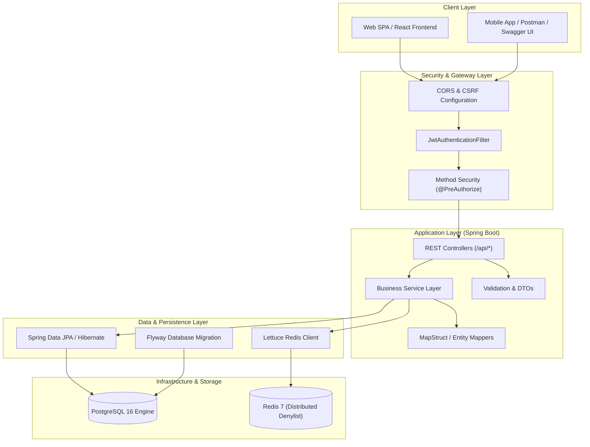
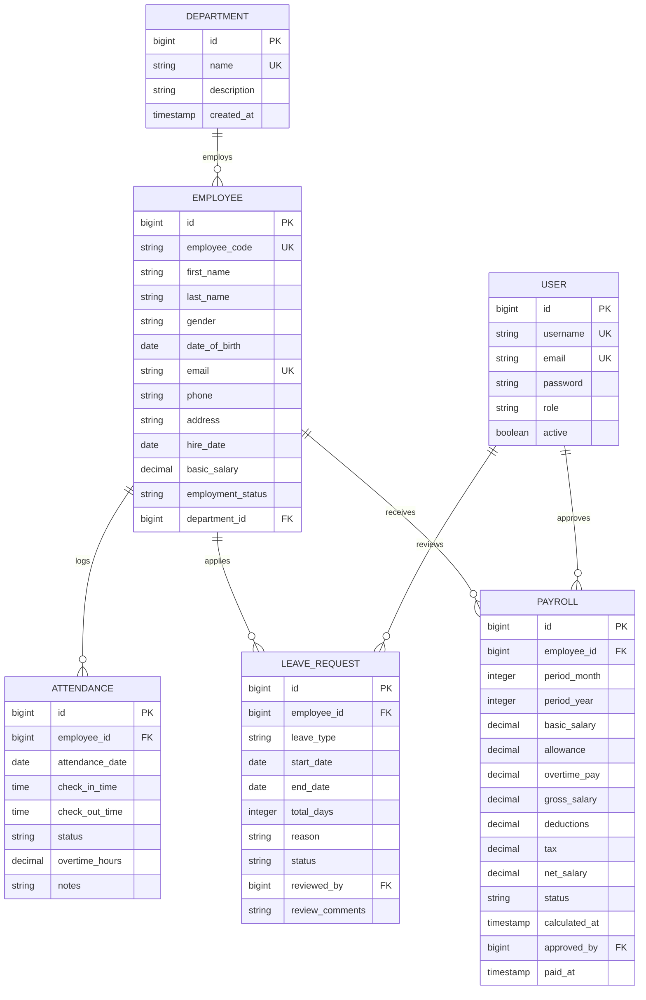
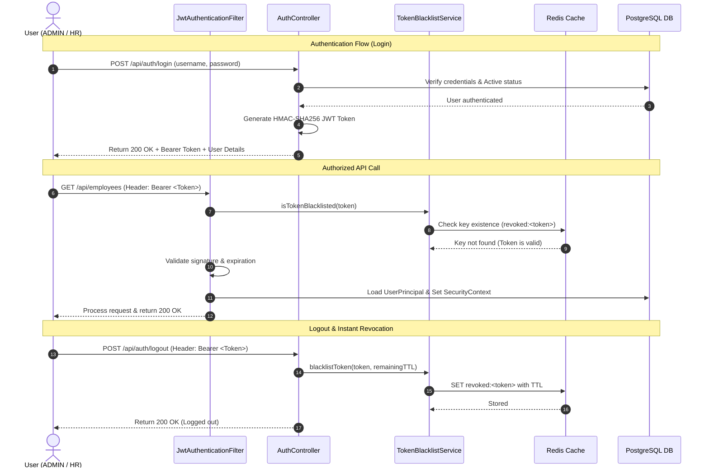
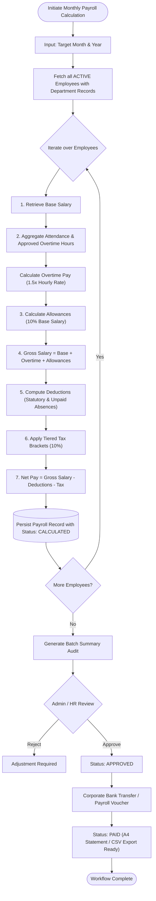

# HR & Payroll Management System REST API

[](https://openjdk.org/)
[](https://spring.io/projects/spring-boot)
[](https://www.postgresql.org/)
[](https://redis.io/)
[](https://www.docker.com/)
[](LICENSE)

An enterprise-grade, highly secure RESTful backend API for **Human Resources, Attendance, Leave Administration, and Automated Payroll Processing**. Built with clean architecture, strict DTO isolation, comprehensive Jakarta Bean Validation, distributed token revocation, and automated database migrations.

---

## 🏛️ System Architecture



---

## 🗄️ Domain Entity Relationship Diagram (ERD)



---

## 🔐 Authentication & Token Lifecycle Workflow



---

## 💰 Automated Payroll Calculation Engine



---

## 🛠️ Technology Stack & Libraries

| Technology | Purpose | Version |
| :--- | :--- | :--- |
| **Java** | High-performance compiled programming language | **25 (LTS)** |
| **Spring Boot** | Application framework & dependency injection engine | **3.5.x** |
| **Spring Security** | Declarative authentication & method-level RBAC | **6.x** |
| **PostgreSQL** | Relational database with ACID transactional integrity | **16-alpine** |
| **Redis** | Distributed in-memory token blacklist & cache | **7-alpine** |
| **JJWT (io.jsonwebtoken)** | JSON Web Token parsing, signing, and verification | **0.12.x** |
| **Spring Data JPA** | Object-Relational Mapping (Hibernate 6) | Spring Boot Starter |
| **Flyway** | Automated database versioning and migrations | **10.x** |
| **Springdoc OpenAPI** | Interactive Swagger UI API documentation | **2.8.x** |
| **Docker & Docker Compose** | Multi-container orchestration & containerization | Multi-stage |

---

## 👥 Role-Based Access Control (RBAC)

The system enforces two strict administrative operational roles:

* **`ADMIN`**: Complete system governance, HR user provisioning, status toggles, salary audits, and full system configuration.
* **`HR`**: Operations management including employee directory, department allocations, daily attendance logs, leave request reviews, and monthly payroll calculation.

> [!NOTE]
> **No self-service employee login role exists.** Employees represent operational master records managed by `ADMIN` and `HR` personnel.

---

## 🚀 Quick Start & Local Development

### Prerequisites
* **Java 25 JDK** installed and active on your environment
* **PostgreSQL 16+** running locally (or via Docker)
* **Redis 7+** (Optional: application gracefully falls back to concurrent memory if Redis is unavailable)

### Running Locally with Maven Wrapper

1. **Clone the repository:**
   ```bash
   git clone https://github.com/YimLemeng/HR-payroll-system.git
   cd HR-payroll-system
   ```

2. **Configure your local properties:**
   Make a copy of `application-local.yml` or configure your local database credentials:
   ```bash
   cp .env.example .env
   ```

3. **Compile and run the Spring Boot application:**
   ```bash
   ./mvnw clean spring-boot:run
   ```

4. **Verify Application Health & Interactive API Docs:**
   * **Swagger UI:** [http://localhost:8080/swagger-ui.html](http://localhost:8080/swagger-ui.html)
   * **OpenAPI Schema:** [http://localhost:8080/v3/api-docs](http://localhost:8080/v3/api-docs)

---

## 📄 License

This project is licensed under the [MIT License](LICENSE).
